# iCareDonate — Core User Flow Diagrams
> **Version:** 1.0 · **Date:** 2026-10-04  
> Describes the primary journeys for Donors, Requesters, and Admins.  
> These flows drive the development sequence. The vertical slice (Post → Verify → Request → Match → Claim → Complete) must work end-to-end before any secondary features are built.

---

## 1. The Core Product Loop

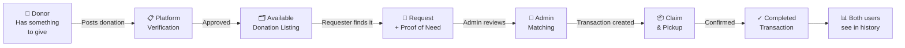

---

## 2. Donation Journey (Donor)

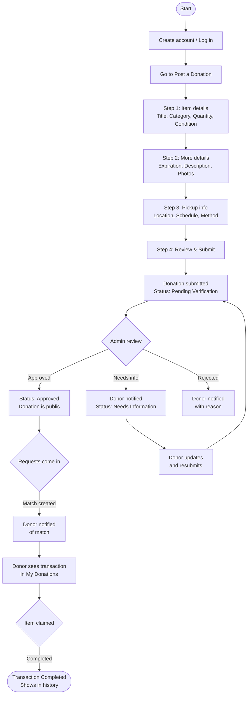

---

## 3. Request Journey (Requester)

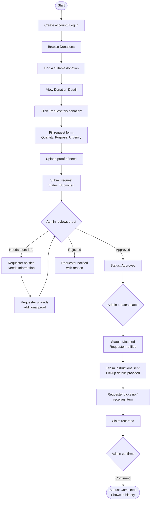

---

## 4. Admin Review Flow — Donations

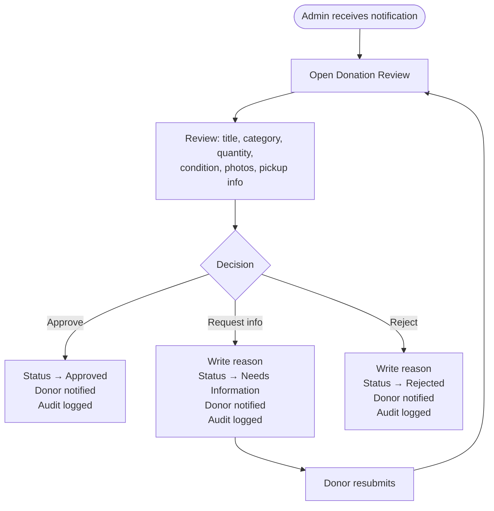

---

## 5. Admin Review Flow — Requests

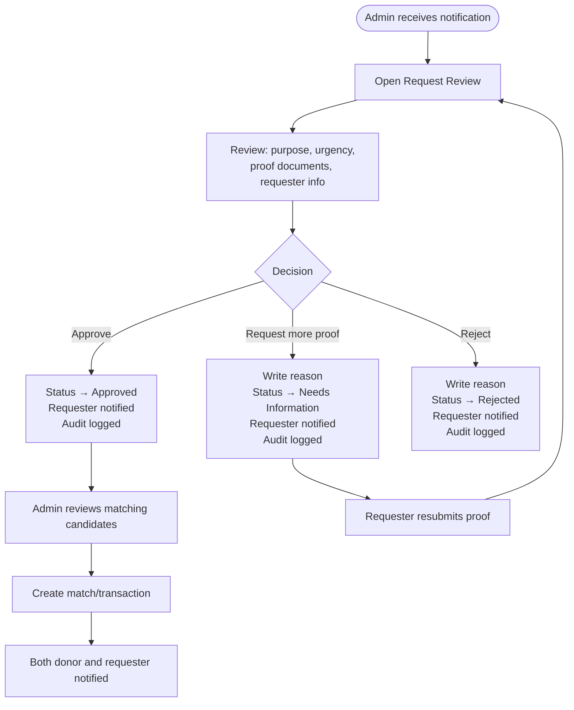

---

## 6. Matching & Transaction Flow (Admin)

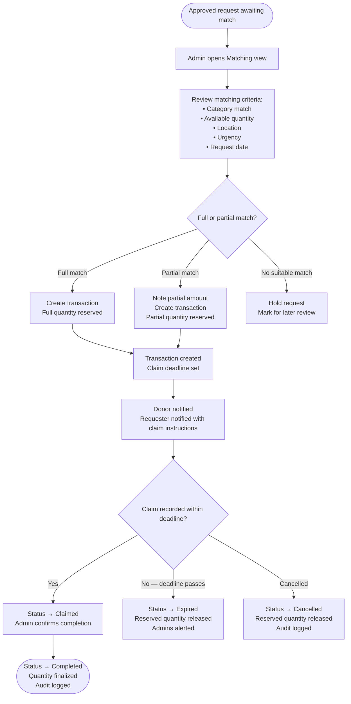

---

## 7. Donation Status Machine

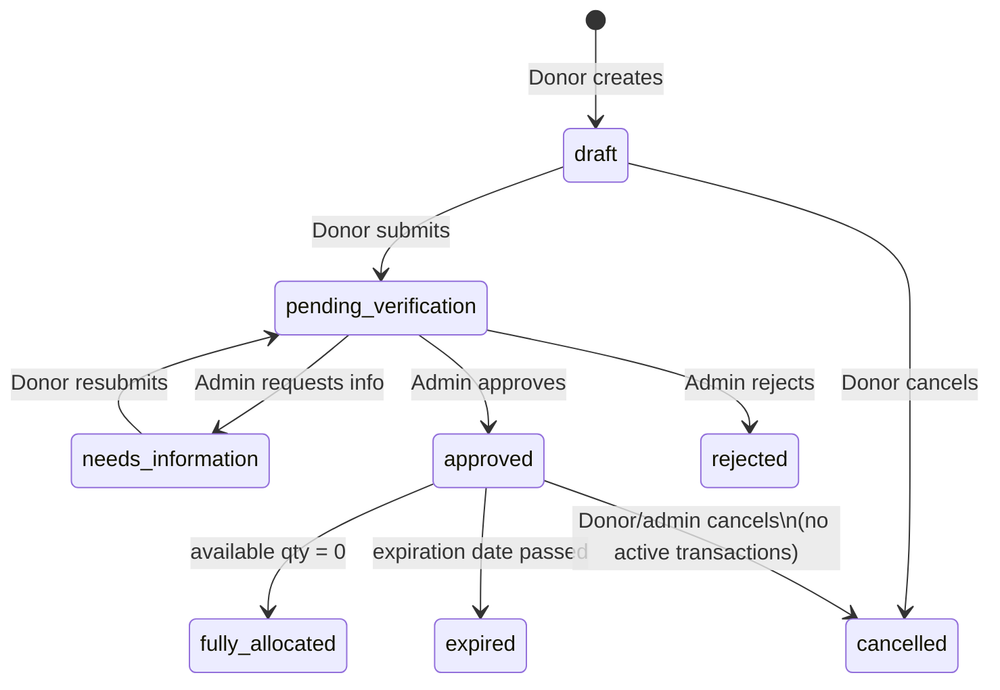

---

## 8. Request Status Machine

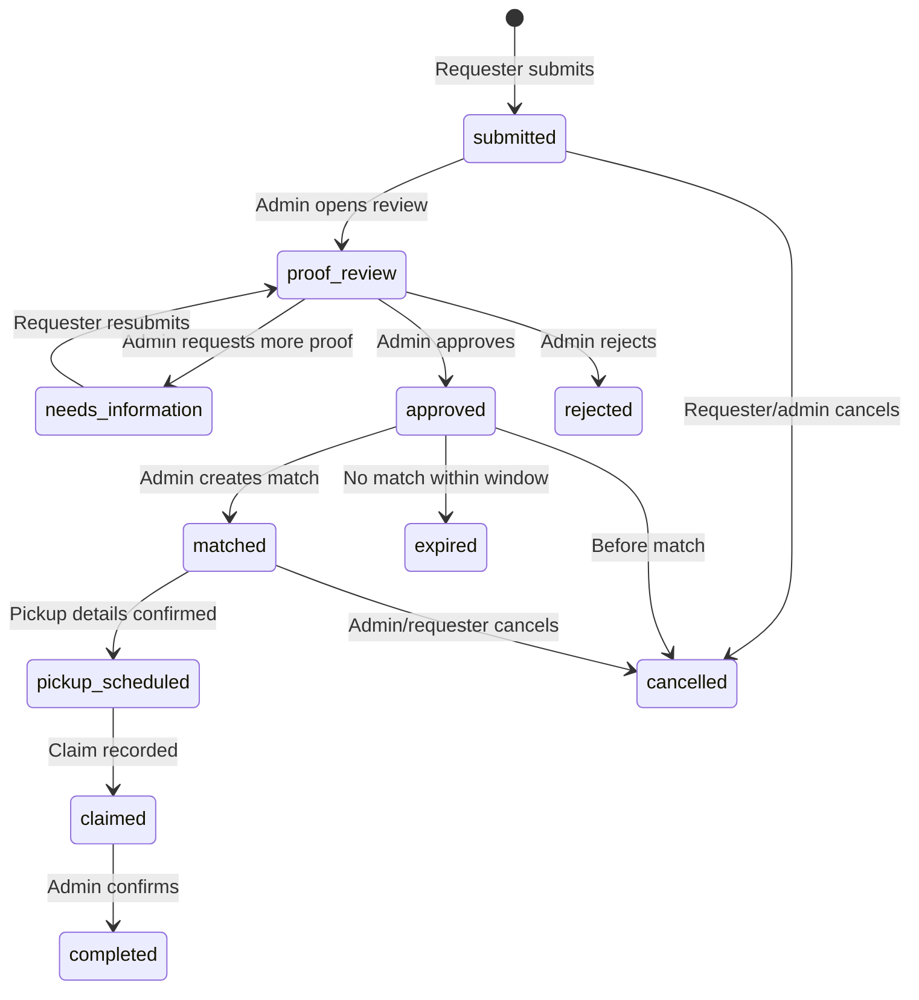

---

## 9. Transaction Status Machine

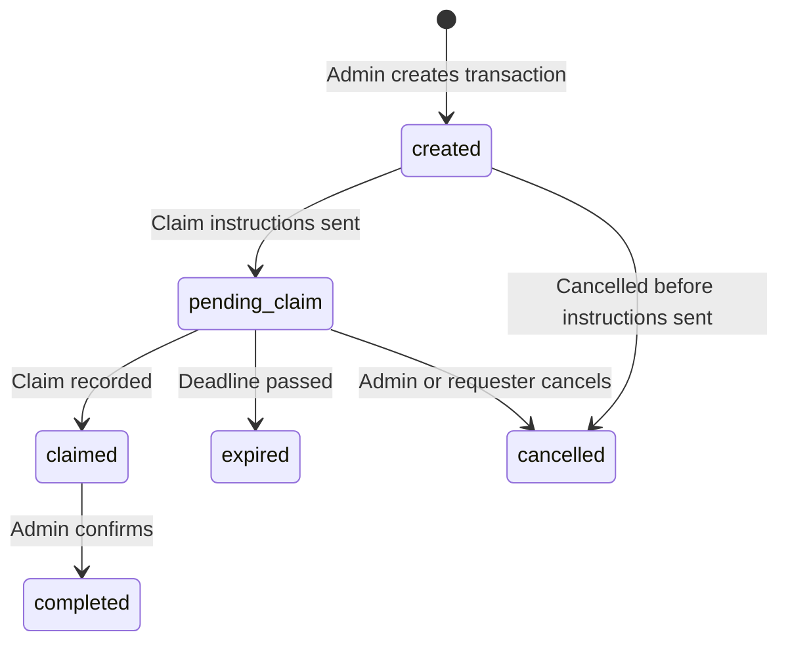

---

## 10. First Vertical Slice — The MVP Flow

This is the first milestone. Every other feature builds on this working foundation.

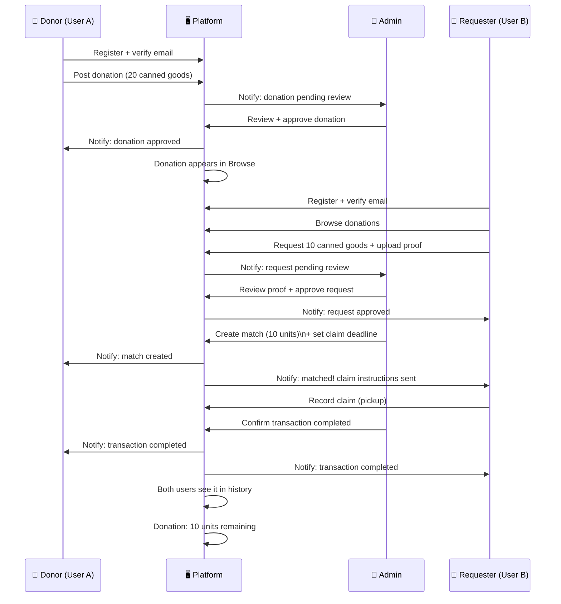

---

## 11. Account & Auth Flows

```mermaid
flowchart LR
    subgraph Public
        A[Visit site] --> B{Has account?}
        B -->|No| C[Register]
        C --> D[Verify email]
        D --> E[Active account]
        B -->|Yes| F[Log in]
        F --> E
    end

    subgraph Recovery
        G[Forgot password] --> H[Enter email]
        H --> I[Receive reset link]
        I --> J[Set new password]
        J --> F
    end

    subgraph Admin
        K[/admin/login] --> L[Admin credentials]
        L --> M{Role check}
        M -->|admin or superadmin| N[Admin dashboard]
        M -->|user or invalid| O[Access denied]
    end
```

---

## 12. Public User Navigation Map

```
Home
├── How It Works
├── Categories
│   └── Browse by category
├── Browse Donations
│   └── Donation Detail
│       └── [Login to request]
├── About
├── Contact
├── FAQ / Help
└── Legal
    ├── Privacy Policy
    └── Terms of Service

Auth
├── Login
├── Register
├── Forgot Password
└── Verify Email
```

---

## 13. User Dashboard Navigation Map

```
Dashboard (overview)
├── My Donations
│   ├── Post a Donation (wizard)
│   └── Donation Detail / Edit / Track
├── Browse Donations
│   └── Donation Detail
│       └── Request Resource
├── My Requests
│   └── Request Detail / Track / Upload Proof
├── Notifications
├── Support
└── Account Settings
    ├── Profile
    ├── Change Password
    └── Delete Account
```

---

## 14. Admin Panel Navigation Map

```
Admin Dashboard (action queue)
├── Donations
│   ├── Pending review
│   ├── All donations
│   └── Donation detail / Review / Approve / Reject
├── Requests
│   ├── Pending review
│   ├── All requests
│   └── Request detail / Review / Approve / Reject
├── Matching
│   ├── Approved requests awaiting match
│   └── Create match / transaction
├── Transactions
│   ├── Active
│   ├── Expiring soon
│   └── History
├── Users
│   ├── All users
│   ├── User detail
│   └── Manage status / role
├── Categories
│   ├── All categories
│   └── Create / Edit / Deactivate
├── Moderation
│   ├── Problem reports
│   └── Warnings / Suspensions / Bans
├── Reports
│   ├── Donation report
│   ├── Request report
│   └── Transaction report
├── Audit Log
└── Settings
```

---

## 15. Development Order (summary)

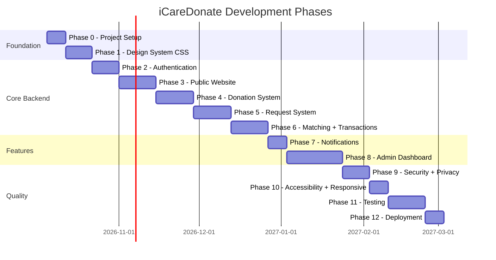
